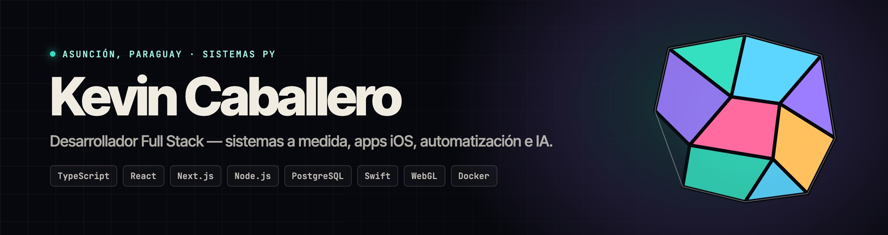
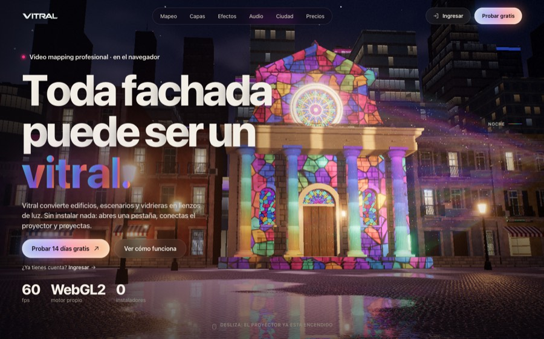
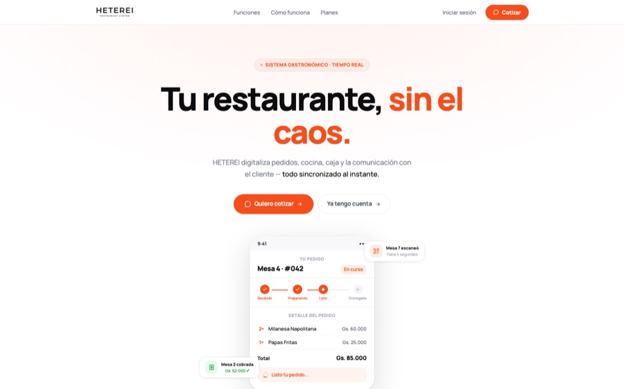
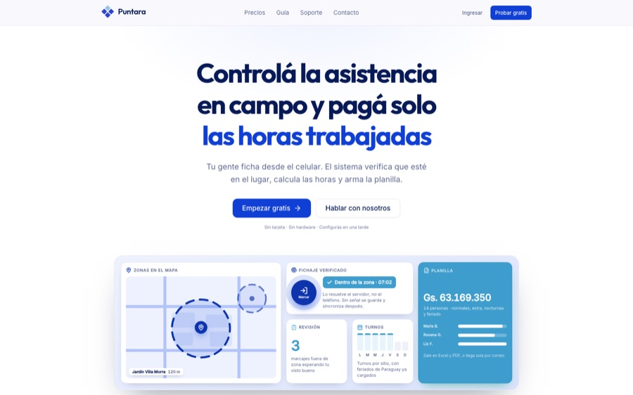
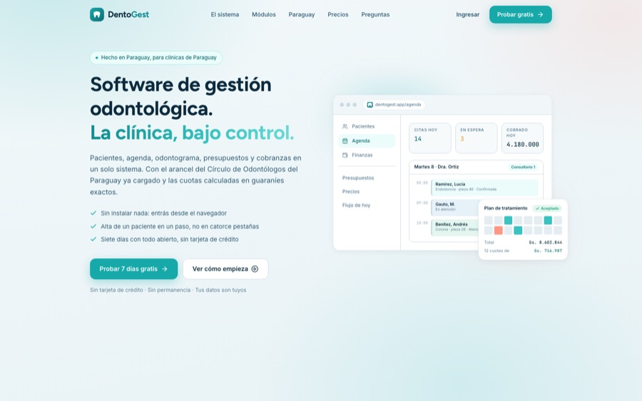
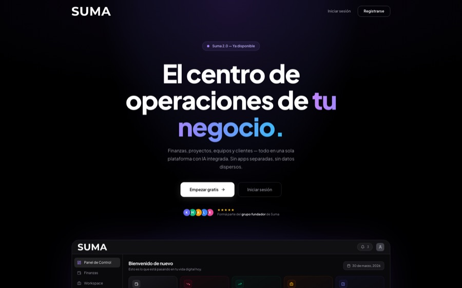

  
  
  
  

---

### Sobre mí

Desarrollador full stack de Asunción, Paraguay. Construyo y opero software a medida bajo mi marca **[Sistemas Py](https://sistemaspy.site)**: sistemas de gestión, productos SaaS, apps iOS y automatizaciones. Me encargo del ciclo completo: relevamiento con el cliente, diseño de interfaz, desarrollo, despliegue y soporte.

- **+20 sistemas en producción**, cada uno con su dominio, su base de datos y el servidor que administro (Docker, nginx, SSL automático, respaldos).
- **Desarrollador frontend en [8bits agency](https://8bitsagency.com)**: paneles internos y advergames para activaciones de marca.
- **Robótica humanoide**: operación, programación e integración con IA del Unitree G1 EDU+.
- Estudiante de **Ingeniería Informática** (UTCD).

---

### Sistemas en producción

<table>
<tr>
<td width="50%" valign="top">

<h4><a href="https://vitral.sistemaspy.site">Vitral</a> · video mapping en el navegador</h4>
Composición por GPU en tiempo real, warp proyectivo y mesh warp, edge blending multiproyector, 120+ generadores GLSL, audio-reactividad, control remoto por QR y modo sin conexión.  
<code>React</code> <code>TypeScript</code> <code>WebGL2</code> <code>Three.js</code> <code>Node.js</code> <code>WebSockets</code>
</td>
<td width="50%" valign="top">

<h4><a href="https://www.heterei.site">Heterei</a> · gestión gastronómica</h4>
Pedidos, cocina, caja y comunicación con el cliente sincronizados en tiempo real. Menú digital por QR, sin apps ni papel. Multinegocio.  
<code>React 19</code> <code>TypeScript</code> <code>Firebase</code> <code>Tiempo real</code> <code>PHP</code>
</td>
</tr>
<tr>
<td width="50%" valign="top">

<h4><a href="https://puntara.sistemaspy.site">Puntara</a> · control de asistencia</h4>
Fichaje desde el celular con verificación por geocercas y cálculo automático de horas normales, extra, nocturnas y feriados. Multiempresa, roles y 2FA.  
<code>Next.js 15</code> <code>PostgreSQL</code> <code>PostGIS</code> <code>Auth.js</code> <code>Docker</code>
</td>
<td width="50%" valign="top">

<h4><a href="https://dentogest.sistemaspy.site">DentoGest</a> · gestión odontológica</h4>
Pacientes, agenda, odontograma, presupuestos con plan de tratamiento por etapas y PDF de marca, cobros y panel multiclínica.  
<code>Next.js</code> <code>NestJS</code> <code>Prisma</code> <code>PostgreSQL</code> <code>Docker</code>
</td>
</tr>
<tr>
<td width="50%" valign="top">

<h4><a href="https://sumawallet.com">SumaWallet</a> · finanzas y productividad</h4>
Wallets, transacciones, proyectos, metas y calendario con IA integrada, más una app iOS nativa que la acompaña.  
<code>React</code> <code>Firebase</code> <code>Swift</code> <code>SwiftUI</code> <code>IA</code>
</td>
<td width="50%" valign="top">

<h4><a href="https://trizia.sistemaspy.site">Trizia</a> · tienda online</h4>
E-commerce de marroquinería: catálogo por categorías, carrito, cuentas de cliente, seguimiento de pedidos y gestión de envíos.  
<code>Next.js</code> <code>Prisma</code> <code>PostgreSQL</code> <code>Tailwind</code>
</td>
</tr>
</table>

**Más proyectos en producción**

| Proyecto | Qué es | Enlace |
|---|---|---|
| **ScoreXPro** | Puntuación, cronometraje y overlays para competencias de deportes extremos, usado en eventos reales | [scorexpro.app](https://scorexpro.app) |
| **QueFotaza** | Galería en vivo para eventos: los invitados suben fotos por QR y aparecen en pantalla al instante | [quefotaza.com](https://quefotaza.com) |
| **SpeedyPrompt** | Ingeniería de prompts en español: convierte una idea suelta en un prompt estructurado | [speedyprompt.site](https://www.speedyprompt.site) |
| **Sistemas Py** | Sitio de la marca, con demo navegable de un panel de gestión | [sistemaspy.site](https://sistemaspy.site) |

---

### Stack

   
  

**También:** WebGL2 y GLSL · PostGIS · n8n y bots de WhatsApp con API autoalojada · integración de modelos de IA · CI/CD y administración de servidores.

---

  
  

¿Tienes un proyecto en mente? Escríbeme a <a href="mailto:kevin@sistemaspy.site">kevin@sistemaspy.site</a> o visita <a href="https://sistemaspy.site">sistemaspy.site</a>.

